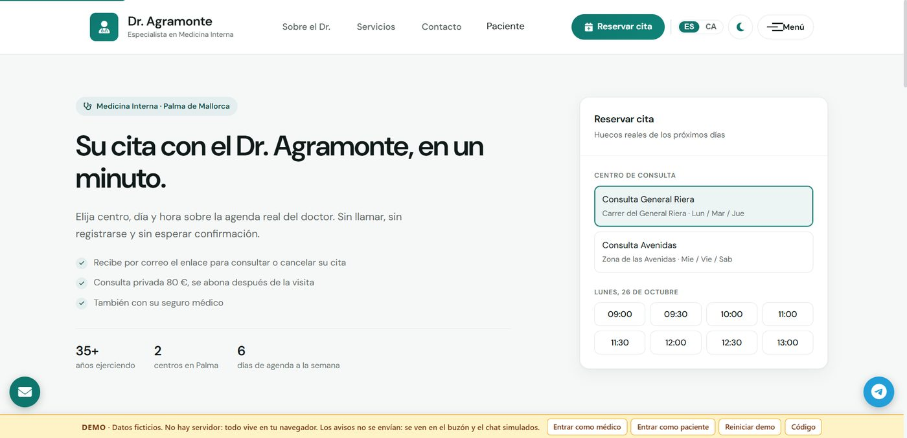
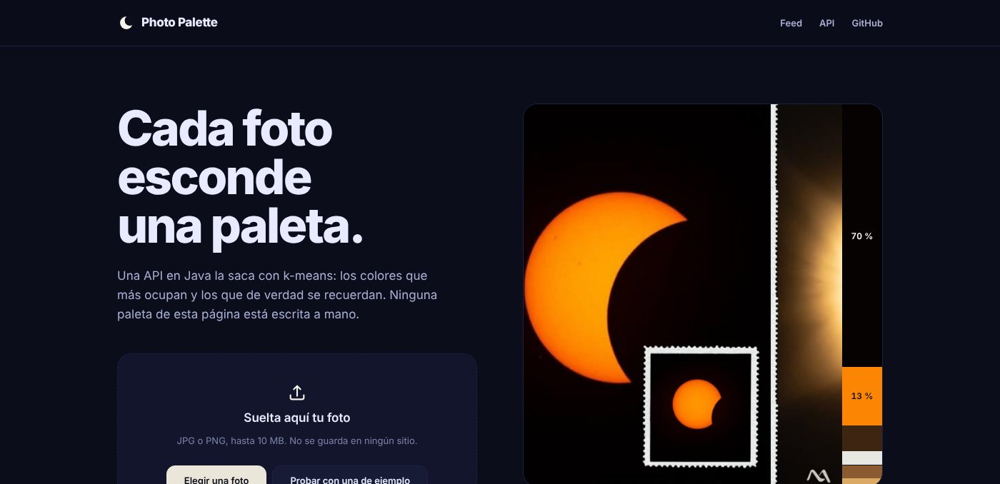
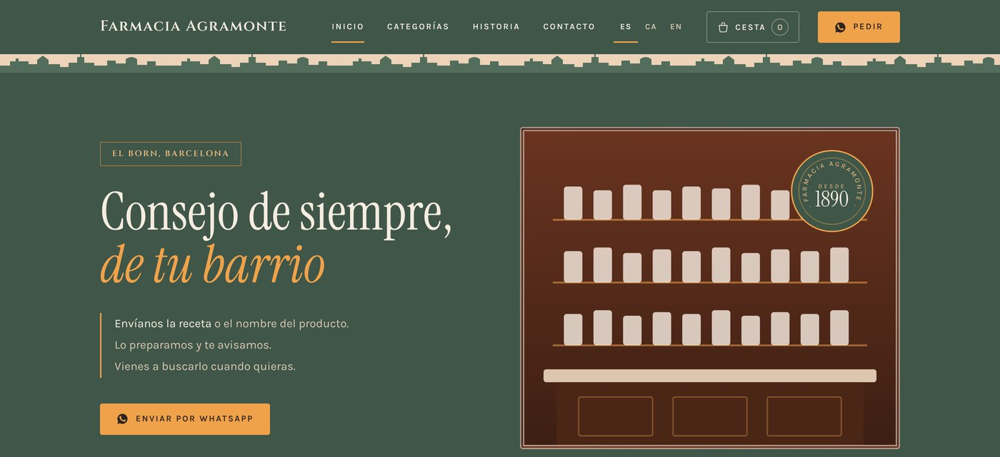

<h1 align="center">Mar Agramonte</h1>

  <b>QA Automation y Backend Java</b> 
  Spring Boot · PostgreSQL · Docker · Playwright · Testing de APIs · 400 h de QA en Marlink 
  Palma de Mallorca · Presencial o híbrido, remoto o reubicación · Incorporación inmediata

  
  
  
  

## Del mostrador al backend

Dos pacientes intentan reservar la misma hora a la vez. Solo uno la consigue y el otro recibe un aviso claro. Eso lo programé yo y lo probé contra una base de datos real.

Vengo de la administración, la recepción y la atención al cliente, y me titulé en DAM en CESUR Mallorca (2024–2026). Se nota cuando programo: lo primero que pienso es quién va a usar esto y qué se le puede romper.

Busco mi primer puesto como QA Automation o desarrolladora backend con Java 21 y Spring Boot. Dejo cada decisión técnica por escrito, con la alternativa que descarté. Uso la IA a diario, pero nada de lo que propone entra sin pruebas.

## Proyectos

### [Dr. Agramonte](https://github.com/maragramonte/dr-agramonte)

App de citas para un internista de Palma. Los pacientes reservan, cambian y cancelan su cita desde el móvil, sin llamar. Backend con Java 21, Spring Boot 3.5, PostgreSQL, JWT y Flyway. El bloqueo pesimista en PostgreSQL evita las reservas dobles, y una prueba de concurrencia lo demuestra.

- 138 pruebas de backend (unitarias, de API y con Testcontainers) y 47 E2E con Playwright, con axe-core para la accesibilidad.
- CI con GitHub Actions en cada push.
- Revisor de pull requests en Python que usa la API de Claude, con 15 pruebas propias. Se activa con una clave de API.
- [Demo](https://demo-dragramonte.maragramonte.com/), con datos ficticios.

### [Photo Palette](https://github.com/maragramonte/photo-palette)

Le das una foto y te devuelve sus colores principales, listos para una web: HEX, RGB, porcentaje y un bloque `:root` para copiar. Java 21 y Spring Boot 3.5, con k-means escrito a mano. La foto se analiza en memoria y no se guarda. Nació de mis fotos del cielo de noche: quería sacar sus colores.

- Modo `vivos`: ignora sombras y ruido y ordena por saturación, para no perder el color por el que hiciste la foto.
- Límites por IP con Bucket4j, semáforo de análisis y errores en ProblemDetail.
- 98 pruebas, con un 97 % de cobertura de líneas. JaCoCo pone un suelo de cobertura en el CI.
- 21 E2E de la web con Playwright, en escritorio y móvil, con axe-core.
- Imagen Docker en GHCR, web en GitHub Pages y API en Render.
- [Pruébala con una foto tuya](https://paleta.maragramonte.com/)

### [Farmacia Agramonte](https://github.com/maragramonte/Farmacia-Agramonte)

La web de una farmacia de barrio real de El Born, en Barcelona. Los clientes ven el catálogo y mandan su encargo por WhatsApp, en castellano, catalán o inglés. Sin cookies ni frameworks.

- No quería mantener 154 páginas a mano: un generador en Python crea 143 a partir de dos JSON.
- El catálogo se importa del CSV del programa de gestión.
- 218 tests de pytest vigilan el generador, el importador y los enlaces.
- [Web](https://farmacia.maragramonte.com/)

### [Mi portfolio](https://github.com/maragramonte/mi-portfolio)

Mi portfolio con React y Vite, en español e inglés, con tema de día y de noche.

- 59 pruebas E2E en un Chrome real: idioma, tema, navegación, filtros, menú del móvil y accesibilidad con axe-core.
- En GitHub Actions corren en cada pull request y antes de cada despliegue. Si falla una, no se publica.
- [Web](https://maragramonte.com/)

### [Proyectos de clase](https://github.com/maragramonte/proyectos-dam)

Una selección de lo que hice en DAM: tres simulaciones de concurrencia en Java, con hilos, semáforos y sockets, y una app Android de tareas en Kotlin con SQLite.

## Experiencia

**Marlink Group (OmniAccess) · Prácticas de desarrollo y QA** · ene–mar 2026 · 400 h · Parc Bit, Palma  
- Pruebas funcionales de la API de Ucopia: diseño de casos, reproducción de fallos e informes en Jira.
- Validación de flujos E2E en entornos simulados y de producción.
- Scripts en Python para consultar SQL y MongoDB desde Docker sobre WSL.
- Equipo ágil con SAFe (Daily, Sprint Planning y PI Planning) y documentación en Confluence.

**GladToLink · Prácticas de consultoría tecnológica** · feb 2025 · 100 h  
Formularios y maquetación en XML, gestión documental con Adobe y Java para botones e interacciones, en proyectos de digitalización.

**Antes de IT**  
Cajera en El Corte Inglés (2025), recepción de las salas VIP del aeropuerto de Palma (2024) y un año en The Ardilaun Hotel de Galway, Irlanda, trabajando en inglés (2023–2024). Antes, prácticas de administración y RRHH en Urbia Servicios Integrales y atención al cliente en Natural World Eco (2021). De allí me traje la calma cuando hay prisa.

## Stack

           

También trabajo con SQL, MySQL, MongoDB, SQLite, APIs REST, JavaScript, HTML, CSS, XML, Git, Linux, WSL, Docker Compose, DBeaver y Odoo. Conozco Scrum, Kanban y SAFe; he utilizado Jira y Confluence.

## Formación e idiomas

- **Técnica Superior en Desarrollo de Aplicaciones Multiplataforma (DAM)** · CESUR Mallorca · 2024–2026
- Español y catalán: nativos · Inglés: B2 (un año trabajando en Irlanda)
