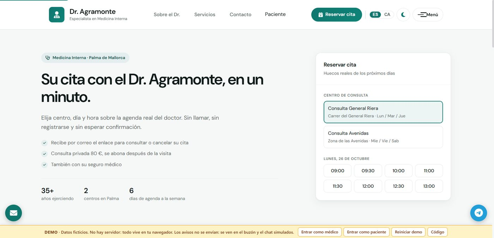
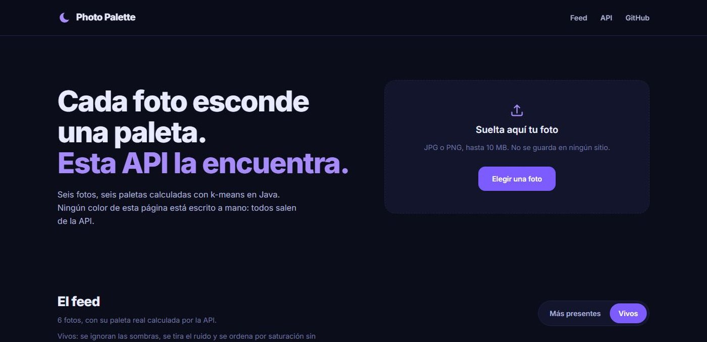
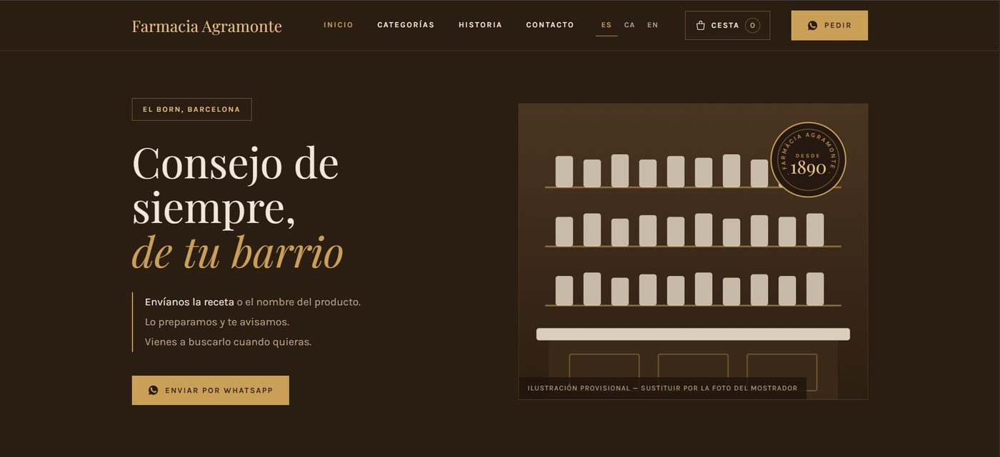

<h1 align="center">Mar Agramonte</h1>

  <b>Desarrolladora backend junior y QA Automation</b> 
  Construyo servicios con Java y Spring Boot, y automatizo pruebas con Python. 
  Palma de Mallorca · Remoto o híbrido · Incorporación inmediata

  
  
  
  
  

## Del mostrador al backend

Trabajé en administración, hostelería y atención al cliente, en Aena, El Corte Inglés y un hotel en Irlanda, antes de estudiar DAM en CESUR (2024–2026). De esos años me quedo con el trato con la gente y con saber trabajar con prisa. En Marlink Group hice 400 horas de prácticas probando APIs, validando flujos E2E y automatizando consultas con Python.

## Proyectos

### [Dr. Agramonte](https://github.com/maragramonte/dr-agramonte)

Aplicación de citas para un internista en Palma. Backend con Java 21, Spring Boot 3.5, PostgreSQL, JWT y Flyway. El bloqueo pesimista y una prueba de concurrencia protegen la reserva de cada cita.

- 115 pruebas unitarias, de API y con Testcontainers.
- Integración continua con GitHub Actions.
- [Demo](https://maragramonte.github.io/dr-agramonte/)

### [Photo Palette](https://github.com/maragramonte/photo-palette)

API que convierte una foto en una paleta de color lista para una web: HEX, RGB, porcentaje y un bloque `:root` para copiar. Java 21 y Spring Boot 3.5, con k-means escrito a mano y la foto analizada en memoria, sin guardarse.

- Modo `vivos`: ignora sombras y ruido y ordena por saturación, para no perder el color que da sentido a la foto.
- Límites por IP con Bucket4j, semáforo de análisis y errores en ProblemDetail.
- 77 pruebas, Docker y despliegue continuo en GitHub Pages.
- [Demo](https://maragramonte.github.io/photo-palette/)

### [Farmàcia Agramonte](https://github.com/maragramonte/Farmacia-Agramonte)

Web real para una farmacia. Un generador en Python crea 190 páginas en tres idiomas; incluye importación de catálogo desde CSV y trabajo de SEO técnico.

- [Web](https://maragramonte.github.io/Farmacia-Agramonte/)

## Experiencia

**Marlink Group (OmniAccess) · Prácticas de desarrollo y QA** · ene–mar 2026 · 400 h  
Pruebas de API y E2E, scripts Python para consultar SQL y MongoDB en Docker, y trabajo con SAFe, Jira y Confluence.

**GladToLink · Prácticas de consultoría tecnológica** · feb 2025 · 100 h  
Maquetación de formularios XML y desarrollo de interacciones con Java para procesos de digitalización.

## Stack

         

También trabajo con SQL, MySQL, MongoDB, SQLite, APIs REST, JavaScript, HTML, CSS, XML, Git, Linux, Docker Compose, DBeaver y Odoo. Conozco Scrum, Kanban y SAFe; he utilizado Jira y Confluence.

**Aprendiendo ahora:** Playwright, para ampliar mi práctica de automatización de pruebas.

## Formación e idiomas

- **Técnica Superior en Desarrollo de Aplicaciones Multiplataforma (DAM)** · CESUR · 2024–2026
- Español y catalán: nativos · Inglés: B2 (experiencia laboral en Irlanda)
